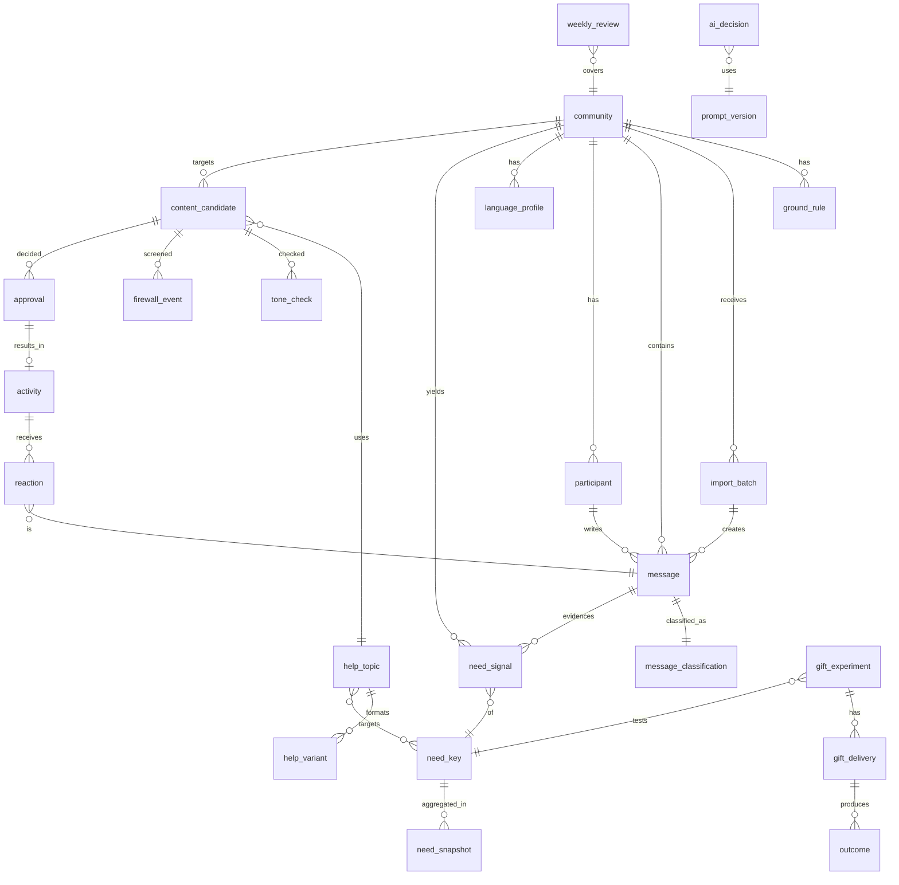

# Community Growth Partner AI — P0 설계안 (v0.1, 검토용)

> 상태: **설계만 했고 코드는 아직 없음.** 승인 전까지 구현하지 않는다.
> 작성일: 2026-11-12 · 기준 문서: Execution Master Prompt v3.0
> 최상위 원칙: **THEIR GROWTH = OUR GROWTH**

---

## 0. 지금 Repository 분석 (설계의 출발점)

| 항목 | 현재 상태 | 설계에 미치는 영향 |
|---|---|---|
| 스택 | Next.js 16.3 (App Router, async `params`), React 19, Tailwind 4, Vitest | 같은 스택으로 `/growth` 모듈을 추가할 수 있음 |
| 데이터 | Notion DB 1개 (`오더` = 주문). `@notionhq/client` v5 `dataSources.query` | Notion은 초당 약 3회 호출 제한이 있고 관계형 조인이 약함 → 메시지 수천 건 분류 저장소로는 맞지 않음 |
| 도메인 | 브랜드 `아삽24`(청소), `에어컨레벨업`(냉난방기 세척) / 고객유형 `B2B/B2G`, `B2C` / 유입경로 당근·블로그·홈페이지·지인 | **운영자가 해당 업종의 현업 사업자다.** "PEER" 포지셔닝이 꾸민 것이 아니라 실제이고, 이것이 가장 큰 신뢰 자산 |
| 인증 | 공용 비밀번호 + HMAC 세션 쿠키, `middleware.ts` matcher | 운영자 1~2명용 관리자 화면은 이 방식으로 충분. matcher에 `/growth`를 추가하면 됨 |
| 기존 기능 | 칸반 보드, 신규 주문, 상세 패널, 고객용 진행상황 추적 페이지 `/track/[token]` | `/track`은 **이미 직접 써보고 있는 도구**. "고객에게 진행상황 링크 보내기"를 Micro Gift / 사례로 활용 가능 |
| 학교 데이터 | 이 repo에는 없음. 별도 `school-cleaning-crm` 플러그인/PC 원장으로 운영 중 | 방화벽 경계: **(a) 학교 원장 시스템**, 그리고 **(b) 이 FSM 앱 안의 `B2B/B2G` 학교 고객 주문**. (b)는 놓치기 쉬움 |

**결론:** 이 FSM CRM은 "운영자 자신의 현장 운영"을 위한 도구이고, Community Growth AI는 "다른 사업자의 성장"을 위한 도구다. 목적과 데이터 주체가 다르므로 **같은 코드베이스에 두되 별도 모듈과 별도 DB로 분리**하는 것을 권장한다(§17, §27-1).

---

## 1. 사업모델 이해

1. 카카오 오픈채팅 등 현업 사업자 Community에 **동료 사업자(PEER)**로 참여한다.
2. 대화에서 반복되는 **사업 문제(Need)**를 찾는다. 키워드가 아니라 근본 니즈 단위로 찾는다.
3. 판매 없이도 가치가 있는 **가장 작은 도움(Next Best Help / Micro Gift)**을 준다.
4. 도움이 실제로 쓰이고(Usage) 반복되고(Repeat) 사업성과로 이어지면(Outcome) 신뢰가 쌓인다.
5. 신뢰 위에서 상대가 원할 때만 Managed Service → Marketing/Automation → SaaS 순으로 유료화한다.
6. Community 반응 데이터가 제품 로드맵을 결정한다(Continuous Discovery).

즉 **"커뮤니티 기반 Product Discovery + 관계형 영업 엔진"**이다. AI는 겉으로 드러나지 않는 뒷단 엔진이다.
P0의 목적은 매출이 아니라 **"우리가 준 도움이 실제로 쓰이고 반복되는가"를 싸게 검증**하는 것이다.

---

## 2. 핵심 사용자와 Value Proposition

| 사용자 | 역할 | 이 사람에게 주는 가치 |
|---|---|---|
| **Operator (운영자, 1명)** | 1차 사용자. 하루 3~5분 승인 | "오늘 어디서 누구를 무엇으로 도우면 되는지 3개만 골라준다. 말투까지 그 방에 맞게." |
| **Community 사업자 (청소·냉난방 사장님)** | 최종 수혜자. 시스템을 직접 쓰지 않음 | "일감·재구매·마케팅에 바로 쓸 수 있는 팁과 작은 결과물을 공짜로, 부담 없이 받는다." |
| **방장 / Community 관리자** | 게이트키퍼 | "광고 없이 방 분위기가 좋아지고 유용한 정보가 늘어난다." |
| (P1) Inbound 문의자 | 관계가 깊어진 사람 | "내 사업 병목 1~2개를 짚어주고 다음 할 일을 알려준다." |

**운영자 관점 한 줄:** *"커뮤니티를 하루 5분만 봐도 놓치는 기회 없이, 광고꾼 소리 안 듣고, 사람들에게 도움이 되는 사람이 된다."*

---

## 3. 핵심 사업가설 Top 10 (검증 순서대로)

| # | 가설 | 검증 지표 | 실패 기준 (Kill) |
|---|---|---|---|
| H1 | 오픈채팅 대화에 **사업 성장 Need가 충분히 자주** 나온다 | 방당 주간 Need signal ≥ 10건, Unique 참여자 ≥ 5명 | 4주간 방당 주 3건 미만 |
| H2 | 표현이 달라도 AI가 **같은 근본 니즈로 묶을 수 있다** | 운영자 검수 일치율 ≥ 80% | 60% 미만 |
| H3 | 판매 없는 도움 콘텐츠에 **반응**한다 (답장, 질문, 고맙다는 말) | 게시물당 반응 ≥ 2건 | 6주 평균 0.5건 미만 |
| H4 | AI가 쓴 초안을 **"사람이 쓴 것처럼"** 보이게 만들 수 있다 | 운영자 무수정 승인율 ≥ 50%, "AI 같다"는 반응 0건 | 수정률 80% 이상 지속 |
| H5 | 사람들이 **Micro Gift를 실제로 요청하고 사용**한다 | 주 2건 이상 요청, 사용 확인 ≥ 50% | 6주간 누적 요청 3건 미만 |
| H6 | Gift를 쓴 사람이 **다시 요청**한다 (Repeat) | 30일 내 재요청 ≥ 30% | 10% 미만 |
| H7 | Gift가 상대 사업에 **측정 가능한 성과**를 만든다 (문의·재방문·계약) | 자기 보고 성과 ≥ 사용자의 25% | 근거 있는 성과 0건 |
| H8 | 운영자 시간이 **하루 5분 이내**로 유지된다 | Today 화면 체류시간 중앙값 | 15분 이상 지속 |
| H9 | 반복 니즈 중 일부는 **돈을 낼 의향(WTP)**이 있다 | "이거 매달 해주면 얼마예요?" 같은 질문, 유료 테스트 수락 | 90일간 0건 |
| H10 | 동종업 경쟁자인 운영자를 **신뢰하고 고객 데이터를 맡길 수 있다** | 고객명단 Gift 수락률 | 제안 대비 수락 10% 미만이면 "본인이 직접 돌리는 도구" 방식으로 전환 |

> 리스크 관리자 의견: H10이 가장 위험한 숨은 가설이다. 운영자가 같은 업종이라는 점은 **PEER 신뢰의 원천이면서 동시에 "내 고객 빼가려는 거 아냐?"라는 의심의 원천**이기도 하다. 그래서 고객 데이터를 받는 Gift는 처음부터 "업로드 없이 본인이 직접 쓰는 템플릿/시트" 버전을 함께 준비한다.

---

## 4. P0 / P1 / P2 / NOT NOW

v3.0의 P0 16개를 그대로 받되, **"코드로 만들 것(BUILD)"**과 **"처음엔 테이블과 운영절차만 둘 것(MANUAL)"**으로 나눴다. 사람이 대신 처리하는 Wizard-of-Oz 방식이고, 개발비를 약 40% 줄인다.

| # | P0 기능 | 방식 | 이유 |
|---|---|---|---|
| 1 | Community Registry | BUILD (CRUD) | 모든 데이터의 기준 키 |
| 2 | Ground Rules | BUILD (텍스트 + 구조화 플래그) | 리스크 체크의 입력값 |
| 3 | Message Import | BUILD | 카카오 "대화 내보내기" txt 파서 + 붙여넣기 |
| 4 | Message Classification | BUILD (LLM 배치) | 핵심 엔진 |
| 5 | Need Radar | BUILD (SQL 집계 + 점수) | 핵심 엔진. 임베딩은 쓰지 않음 |
| 6 | Growth Help Catalog | BUILD (CRUD + seed 40개) | 200개까지 늘릴 수 있는 스키마 |
| 7 | Private Moat Firewall | BUILD (필수, 테스트 포함) | 타협하지 않는 항목 |
| 8 | Language Profile | BUILD (통계는 결정적 계산, 어휘는 LLM) — 주 1회 | |
| 9 | AI Tone Detector | BUILD (정규식 사전 + LLM 판정) | |
| 10 | Daily Feed Generator | BUILD (파이프라인 1개) | |
| 11 | Next Best Help | BUILD (규칙 게이트 + LLM 선택) | |
| 12 | Micro Gift Experiment | **MANUAL** → 테이블과 상태만 | 처음엔 운영자가 Claude로 직접 만들어 전달 |
| 13 | Today Dashboard | BUILD (단순 리스트 + 버튼) | Fancy 금지 |
| 14 | Human Approval | BUILD (APPROVE/EDIT/SKIP/WAIT/HOLD) | |
| 15 | Activity / Reaction History | BUILD (승인 시 기록 + 반응 수동 입력, 다음 import에서 자동 연결) | |
| 16 | Weekly Review | **반자동** — SQL 뷰 + LLM 요약 1회 | |

| 단계 | 기능 | 진입 조건 (Gate) |
|---|---|---|
| **P1** | AI Receptionist, Messaging Adapter(SMS/알림톡), Business Card Agent, Partner DB, Growth Diagnosis, Relationship CRM(사람 단위), Personalized Feed, Experiment Analytics | H3·H5 통과 + Inbound 주 3건 이상 |
| **P2** | Managed AI Workflow, Marketing Automation, Quote AI, Report AI, CRM Automation, Partner Verification, Network/Matching, Product Roadmap Agent | H6·H9 통과 + 유료 사용자 3명 이상 |
| **NOT NOW** | 자동 게시, 카카오 자동 수집 봇/매크로, 다중 독립 Agent, 임베딩/벡터DB, 결제/빌링, 매칭 ML, 모바일 앱, 멀티테넌트/권한체계, 화려한 차트 | — |

---

## 5. P0 상세 PRD

### 5.1 목표
- 3~5개 Community에서 **8주 동안 H1~H5를 검증**한다.
- 운영자 시간은 하루 5분, import를 포함해 주 30분 이내.

### 5.2 범위 밖
자동 게시, 1:1 DM 자동 발송, 사람 단위 프로파일링(P1), 결제.

### 5.3 기능 요구사항 (요약)

**FR-1 Community Registry**
- 필드: 이름, 플랫폼(kakao_openchat|naver_cafe|band|other), 업종(vertical), 지역, 인원수, 방 성격 태그(구인구직/일감공유/정보/잡담), **Relationship Stage**(OBSERVE→…→BUSINESS), 상태(ACTIVE/HOLD/STOP), 운영자 참여 닉네임, 게시 빈도 상한.

**FR-2 Ground Rules**
- 원문 공지 붙여넣기 → LLM이 구조화: `ad_allowed`(Y/N/조건부), `links_allowed`, `dm_allowed`, `self_promo_days`, `banned_topics[]`.
- 모든 Content Candidate는 이 규칙을 통과해야 승인 버튼이 켜진다.

**FR-3 Message Import**
- 입력: 카카오톡 "대화 내보내기" txt(PC, Android, iOS 형식 각각) 또는 붙여넣기.
- 처리: 파싱 → **PII 제거**(전화번호, 이메일, 사업자번호, 상세주소, 계좌) → 닉네임을 `participant_hash`로 가명 처리(Community별 salt) → 중복 제거(해시: community+시각+가명+본문).
- 증분 import: 이미 들어온 메시지는 건너뜀.
- 원문 보관 기간: **30일**. 이후에는 분류 결과와 마스킹된 짧은 근거 문장만 남김(§27-6에서 결정).

**FR-4 Message Classification**
- 대화 맥락을 유지하기 위해 메시지를 시간 창(window, 예: 40개) 단위로 묶어 배치 처리.
- 출력: WHO / INTENT / UNDERLYING_NEED / need_key / intensity(1~3) / SHOULD_ENGAGE / OUR_ROLE / confidence / reason. JSON 스키마는 structured outputs로 강제.
- 대부분은 `CASUAL / NO / OBSERVER`가 정상. 이걸 걸러내는 게 핵심.

**FR-5 Need Radar**
- `need_key` 단위로 집계(§9 통제 어휘). 점수 공식은 §15.
- 일간 Top Needs 5개와 주간 Top Needs 10개. 각 항목에 근거 메시지 3개를 마스킹해서 첨부.

**FR-6 Growth Help Catalog** — §10 스키마, seed 40개(§11에 30개 예시).

**FR-7 Private Moat Firewall** — §14. 출력 전 반드시 통과. 차단되면 `firewall_event`에 기록.

**FR-8 Language Profile** — §12. Community별로 주 1회 재계산.

**FR-9 AI Tone Detector** — §13. 0~100 점수 + 문제 구절 하이라이트 + 수정안.

**FR-10 Daily Growth Feed** — §8 파이프라인. 방마다 하루 **최대 1개 후보**를 만들고, `WAIT/NO_ACTION`도 정식 결과로 취급.

**FR-11 Next Best Help** — §15.

**FR-12 Micro Gift Experiment** — §16. 상태: OFFERED→REQUESTED→DELIVERED→USED→REPEATED→OUTCOME_REPORTED→PAID_INTEREST.

**FR-13 Today Dashboard / FR-14 Approval** — §20, §22.

**FR-15 Activity / Reaction** — 승인된 게시물은 운영자가 직접 붙여넣어 게시(카카오 ToS 준수). 다음 import 때 게시 이후 24시간 안의 답장과 언급을 자동으로 연결해 반응 수를 셈.

**FR-16 Weekly Review** — §21.

### 5.4 비기능 요구사항
- 모든 AI 판단은 `ai_decision` 테이블에 기록(§ 감사성).
- 방화벽 테스트 커버리지 100%(금지어 / 데이터소스 / 출력 검사 각각 단위 테스트).
- LLM 비용 상한: 월 5만원(예상치는 약 3만원 미만, §18).

---

## 6. Operator User Journey

```
[주 2회, 10분]  각 방 "대화 내보내기" → /growth/import 에 드롭
                     ↓ (자동, 수 분)
              분류 → Need Radar → 후보 생성 → 톤 체크 → 방화벽
                     ↓
[매일 아침 3~5분] /growth/today
   1) TOP 3 ACTIONS 확인
   2) 각 카드: 근거 보기(접힘) → APPROVE / EDIT / SKIP / WAIT / HOLD
   3) APPROVE → "복사" 버튼 → 카톡에 직접 붙여넣기 → "게시함" 체크
   4) Gift 요청 온 것 1건 → Claude로 결과물 제작 → 전달 → 상태 갱신
[주 1회 10분]   /growth/weekly → KEEP/INCREASE/DECREASE/STOP/EXPERIMENT 결정
```

**핵심 UX 원칙:** 운영자가 "생각"해야 하는 건 승인 여부뿐이다. 근거, 말투, 리스크는 이미 카드에 들어 있어야 한다.

---

## 7. Community Journey (Slow Start)

| Stage | 기간(권장) | 허용 행동 | 승급 조건 | 강등/정지 조건 |
|---|---|---|---|---|
| OBSERVE | 1~2주 | NO_ACTION만 (분석만) | 메시지 300건 이상 + Language Profile 생성 | — |
| PARTICIPATE | 1~2주 | 질문에 짧게 답하기(ANSWER), 공감 | 답변 3회 + 부정 반응 0 | 부정 반응 1회 → HOLD |
| CONTRIBUTE | 2~3주 | TIP/QUESTION/HUMOR 게시 (주 2회 이하) | 게시물 평균 반응 ≥ 1.5 | "광고?" 반응 → 1단계 강등 |
| ENGAGE | 상시 | 체크리스트, 사례 공유, "이런 거 필요하세요?" 질문 | 관심 표명 ≥ 3명 | |
| GIFT | 상시 | Micro Gift 제안 (월 2회 이하) | Gift 사용 ≥ 2건 | 방장 경고 → STOP |
| CONNECT | P1 | 1:1 도움, 명함, 협력사 소개 | 사업성과 1건 이상 | |
| BUSINESS | P1~P2 | 상대가 먼저 요청할 때만 유료 제안 | — | |

**HOLD:** 7일간 모든 게시 중지, 분석만 진행. **STOP:** 방 탈퇴 또는 영구 관찰 모드. Agent는 Stage가 허용하지 않는 행동은 **후보로도 만들지 않는다**.

---

## 8. Message Intelligence Taxonomy

### 8.1 WHO (해당 메시지에서 드러난 역할. 사람에 고정하지 않음)
| 코드 | 정의 | 예 |
|---|---|---|
| SUPPLIER | 서비스를 제공하는 사업자 입장 | "저희는 시스템에어컨 4way 전문입니다" |
| BUYER | 서비스를 찾는 입장 (원청, 관리소장, 고객) | "강남 상가 정기청소 업체 구합니다" |
| OTHER | 구직자, 교육업자, 장비판매 등 | |
| UNKNOWN | 판단 불가 | |

### 8.2 INTENT
`DEMAND`(일감 의뢰), `SUPPLY`(일감 받습니다), `RECRUITMENT`, `JOB_SEEKING`, `SALES_PAIN`, `MARKETING_PAIN`, `CRM_PAIN`, `PRICING`, `PRODUCTIVITY_PAIN`, `AI_INTEREST`, `BUSINESS_QA`, `CASUAL`, `HUMOR`, `COMPLAINT`, `UNKNOWN`
- 메시지 하나에 여러 INTENT가 붙을 수 있음. `primary_intent` 1개 + `secondary[]`.

### 8.3 SHOULD_ENGAGE 판정 규칙 (LLM 판단 뒤에 규칙으로 덮어씀)
| 조건 | 결과 |
|---|---|
| Community Stage = OBSERVE | 항상 `NO` |
| DEMAND/SUPPLY/RECRUITMENT/JOB_SEEKING (일감·구인 거래) | `NO` (거래에 끼어들지 않음. 단, 질문이 들어 있으면 예외) |
| CASUAL/HUMOR | `NO` (Language Profile 학습용으로만 사용) |
| 이미 다른 사람이 충분히 답함 | `NO` |
| *_PAIN, BUSINESS_QA + 답이 아직 없음 + 6시간 이내 | `YES` |
| *_PAIN인데 같은 Need가 반복됨 (Radar 상위) | `WAIT` → Daily Feed 후보로 넘김 |
| COMPLAINT(업계 불만, 고객 갑질 등) | `WAIT` (공감만 가능하고 해결책을 들이밀지 않음) |

### 8.4 OUR_ROLE
| Role | 언제 | 톤 |
|---|---|---|
| OBSERVER | 기본값. 개입 불필요 | — |
| PEER | 공감, 경험 공유 | "저도 이번 달 똑같아요ㅠ" |
| HELPER | 구체적인 질문에 답 | "그거 이렇게 하면 돼요" |
| EXPERT | 반복 Need에 체계적인 팁 | 체크리스트 |
| PROVIDER | 상대가 명시적으로 요청할 때만 | "필요하시면 해드릴게요" |
| CONNECTOR | 다른 사람이나 자원과 연결 | "○○님이 그거 잘 아시던데요" (P1) |

---

## 9. Need Taxonomy (통제 어휘 = 임베딩 대신 사용)

LLM이 자유 텍스트 대신 아래 `need_key` 중 하나를 고르게 한다. 맞는 게 없으면 `OTHER.<짧은 영문 slug>`를 제안하고, 운영자가 주간 리뷰에서 승격하거나 병합한다. **"표현이 달라도 같은 문제로 묶는" 일은 이 통제 어휘가 맡는다.**

| Need Type | need_key (예시) | 대표 발화 |
|---|---|---|
| NEW_CUSTOMER | `NO_INQUIRIES` | "요즘 일이 없어요", "전화가 안 오네요" |
| | `SEASONAL_SLUMP` | "에어컨 끝나니까 손가락 빨아요" |
| | `PLATFORM_DEPENDENCE` | "숨고 수수료 너무 비싸요", "당근 말고 뭐 있어요?" |
| | `NEW_REGION_ENTRY` | "경기 남부 쪽으로 넓혀보려는데" |
| SALES | `QUOTE_NO_CLOSE` | "견적만 나가고 잡히는 게 없네요" |
| | `PRICE_SHOPPING` | "여기저기 견적 돌리는 고객만" |
| | `B2B_ENTRY` | "상가/사무실 정기계약 따는 법?" |
| CONVERSION | `SLOW_RESPONSE` | "현장에 있으면 전화를 못 받아서" |
| | `NO_FOLLOWUP` | "견적 보내고 연락 안 하게 되더라고요" |
| REPEAT_BUSINESS | `NO_RECALL_SYSTEM` | "작년 고객한테 다시 연락을 안 해봤네" |
| | `REFERRAL_ASK` | "소개 좀 받고 싶은데 말을 못 꺼내겠어요" |
| MARKETING | `NO_TIME_TO_POST` | "블로그 써야 하는데 시간이 없어요" |
| | `REVIEW_COLLECTION` | "리뷰 부탁하기가 애매해요" |
| | `PHOTO_CONTENT` | "작업사진은 많은데 활용을 못 해요" |
| CRM | `CUSTOMER_LIST_SCATTERED` | "고객이 다 폰에 있어요" |
| PRICING | `UNDERPRICING` | "단가가 너무 떨어졌어요" |
| | `QUOTE_STRUCTURE` | "출장비 따로 받으세요?" |
| WORKFORCE | `HIRING_HELPER` | "보조 기사 구하기 힘들어요" |
| | `NO_SHOW_STAFF` | "알바가 당일 펑크" |
| PRODUCTIVITY | `PAPERWORK_REPORT` | "완료보고서 쓰는 게 일이에요" |
| | `SCHEDULING` | "일정 꼬여서 하루 날림" |
| AI | `AI_CURIOUS` | "GPT로 견적서 써보신 분?" |
| INFORMATION | `TECHNIQUE`, `CHEMICAL`, `EQUIPMENT`, `TAX_ADMIN` | "곰팡이 약품 뭐 쓰세요?" |
| NETWORK | `WORK_SHARING`, `PARTNER_REFERRAL` | "목공 잘하는 분 소개 좀" |

**우선순위 가중치(v3.0 §1 반영):** NEW_CUSTOMER 1.0 · SALES/CONVERSION 0.9 · REPEAT 0.85 · MARKETING 0.8 · PRICING/BUSINESS 0.7 · PRODUCTIVITY 0.6 · AI 0.5 · INFORMATION 0.4

---

## 10. Growth Help Catalog Schema

```ts
HelpTopic {
  id: string                 // "GRW-001"
  title: string
  category: 'GROWTH'|'SALES'|'CRM'|'MARKETING'|'PRICING'|'BUSINESS'|'FIELD'|'AI_SKILL'|'AUTOMATION'|'NETWORK'|'HUMOR'
  verticals: string[]        // ['cleaning','hvac_cleaning','interior','carpentry','facility', '*']
  market: 'B2B'|'B2C'|'BOTH'
  target_need_keys: string[] // §9 need_key
  core_knowledge: string     // 이 주제의 '사실' (내부용, 그대로 게시하지 않음)
  practical_action: string   // 오늘 바로 할 수 있는 한 가지
  difficulty: 1|2|3
  expected_value: 'NEW_LEAD'|'CONVERSION'|'REPEAT'|'TIME_SAVED'|'COST_SAVED'|'RELATIONSHIP'
  micro_gift: { possible: boolean, gift_type?: string, effort_min?: number }
  potential_paid_service?: string    // 내부 메모. 게시 콘텐츠에 절대 넣지 않음
  shareability: 'SHAREABLE'|'PRIVATE'  // PRIVATE = 내부 노하우, 외부 게시 금지
  source: 'OPERATOR_EXPERIENCE'|'PUBLIC_KNOWLEDGE'|'COMMUNITY_DERIVED'
  firewall_checked_at: Date          // 방화벽 검사 통과 시각
  status: 'DRAFT'|'ACTIVE'|'RETIRED'
  stats: { used, reactions, gifts_requested } // 집계 뷰
}

HelpVariant {             // 하나의 Topic → 여러 Format
  topic_id, format: 'TIP'|'QUESTION'|'INFORMATION'|'HUMOR'|'CASE'|'CHECKLIST'|'MICRO_GIFT'|'EXPERIMENT'|'CTA',
  template: string,       // 방 말투 적용 전 기본 문장
  community_id?: string,  // 방에 맞춰 바꾼 버전 (선택)
  last_used_at
}
```
200개 이상 늘어나도 그대로 쓸 수 있다. 카테고리 × Need × Format 조합으로 후보를 뽑는다.

---

## 11. 초기 Help Topic 예시 30개 (청소 / 냉난방기 세척 Vertical)

| ID | Category | Title | Target need_key | 오늘 할 수 있는 한 가지 | Gift | 잠재 유료 서비스(내부) |
|---|---|---|---|---|---|---|
| GRW-01 | GROWTH | 비수기(11~2월) 에어컨 고객에게 '정기 실내청소' 묶음 제안 | SEASONAL_SLUMP | 올여름 고객 20명에게 겨울 할인 문자 | 문자 3종 | 시즌 캠페인 대행 |
| GRW-02 | GROWTH | 작업 끝나고 "주변에 필요한 분 있으면" 한 문장 | REFERRAL_ASK | 다음 현장에서 바로 말해보기 | 문구 카드 | — |
| GRW-03 | GROWTH | 숨고/당근 수수료 줄이는 '자체 재문의 채널' 만들기 | PLATFORM_DEPENDENCE | 명함에 카톡채널 QR 넣기 | QR 명함 시안 | 채널 세팅 대행 |
| GRW-04 | GROWTH | 상가 관리소장 대상 B2B 첫 연락 방법 | B2B_ENTRY | 건물 1곳 관리사무소 방문 | 소개서 1장 | B2B 영업자료 |
| SAL-01 | SALES | 견적 후 48시간 Follow-up 문자 3단계 | NO_FOLLOWUP | 지난주 견적 고객에게 1통 | 문자 템플릿 | Follow-up 자동화 |
| SAL-02 | SALES | 전화 문의 때 '방문일 먼저 잡기' 스크립트 | QUOTE_NO_CLOSE | 다음 통화에서 써보기 | 스크립트 | — |
| SAL-03 | SALES | 견적서에 비포/애프터 사진 3장 넣기 | QUOTE_NO_CLOSE | 견적 양식 수정 | 견적 양식 | Quote AI |
| SAL-04 | SALES | 가격 비교하는 고객에게 '포함 항목 표'로 답하기 | PRICE_SHOPPING | 포함/미포함 표 만들기 | 표 템플릿 | — |
| SAL-05 | SALES | 현장 중 못 받은 전화 30분 내 문자 콜백 | SLOW_RESPONSE | 부재중 자동문자 설정 | 문구 | AI 응대 |
| CRM-01 | CRM | 폰 연락처 → 엑셀 고객명단 10분 정리법 | CUSTOMER_LIST_SCATTERED | 최근 50명 정리 | 빈 시트 템플릿 | CRM 세팅 |
| CRM-02 | CRM | 에어컨 세척 1년 주기 재방문 알림 (4~5월 사전예약) | NO_RECALL_SYSTEM | 작년 5~7월 고객 추리기 | 재접촉 후보 정리 | 재구매 캠페인 |
| CRM-03 | CRM | 휴면고객 재접촉 문자 "작년 이맘때 해드렸던" | NO_RECALL_SYSTEM | 10명에게 발송 | 문자 + 대상 정리 | Managed CRM |
| CRM-04 | CRM | 고객 메모 3줄 규칙 (집 구조, 주차, 특이사항) | CUSTOMER_LIST_SCATTERED | 오늘 현장부터 적기 | 메모 양식 | — |
| MKT-01 | MARKETING | 작업사진 5장으로 블로그 글 1편 만드는 구조 | NO_TIME_TO_POST, PHOTO_CONTENT | 사진 5장 고르기 | **사진 5장 → 글 샘플 1건** | 블로그 대행 |
| MKT-02 | MARKETING | 당근 비즈프로필 '소식' 주 1회 | NO_INQUIRIES | 이번 주 1개 올리기 | 소식글 3개 | SNS 운영 |
| MKT-03 | MARKETING | 네이버 플레이스 리뷰 요청 타이밍(작업 직후 X, 다음 날 O) | REVIEW_COLLECTION | 어제 고객에게 요청 | 요청 문자 | 리뷰 관리 |
| MKT-04 | MARKETING | 리뷰 답글 템플릿 (칭찬 / 불만) | REVIEW_COLLECTION | 밀린 답글 3개 달기 | 답글 5종 | — |
| MKT-05 | MARKETING | 짧은 영상: 필터 꺼내는 3초 컷이 제일 잘 먹힘 | PHOTO_CONTENT | 다음 현장에서 촬영 | 촬영 가이드 | 숏폼 편집 |
| PRC-01 | PRICING | 최저가 경쟁 대신 기본/추천/프리미엄 3옵션 견적 | UNDERPRICING | 다음 견적에 적용 | 옵션표 | — |
| PRC-02 | PRICING | 출장비·주차비·고소작업비 명시 문구 | QUOTE_STRUCTURE | 견적 하단에 추가 | 문구 | — |
| PRC-03 | PRICING | 건당 원가 계산 (인건비, 약품, 이동, 소모품) | UNDERPRICING | 최근 5건 계산 | 계산 시트 | — |
| BIZ-01 | BUSINESS | 당일 취소/노쇼 규정 안내 문구 | SCHEDULING | 예약 확정 문자에 넣기 | 문구 | — |
| BIZ-02 | BUSINESS | 분쟁 예방: 작업 전 사진 촬영 체크리스트 | (COMPLAINT) | 오늘 현장부터 | 체크리스트 | Report AI |
| BIZ-03 | BUSINESS | 보조 기사 일당/교육 관행 (질문형) | HIRING_HELPER | — (질문으로 대화 유도) | — | — |
| FLD-01 | FIELD | 냄새/곰팡이 재발 클레임 고객 설명 문구 | TECHNIQUE | 문구 저장 | 설명 카드 | — |
| FLD-02 | FIELD | 입주청소 하자 체크리스트를 고객에게 주기 (신뢰+재방문) | REFERRAL_ASK | 다음 입주청소에 전달 | 체크리스트 PDF | — |
| AIS-01 | AI_SKILL | 작업사진 넣으면 완료보고서 초안 만들기 | PAPERWORK_REPORT | 1건 해보기 | **보고서 샘플 1건** | Report AI |
| AIS-02 | AI_SKILL | 고객 문의 문자 답장 초안 받기 | SLOW_RESPONSE | 1건 해보기 | 프롬프트 1개 | AI 응대 |
| AUT-01 | AUTOMATION | 고객에게 '진행상황 링크' 보내기 (운영자 실사용 사례) | SLOW_RESPONSE | — (사례 공유) | 체험 링크 | FSM SaaS |
| HUM-01 | HUMOR | "에어컨 커버 처음 열었을 때 고객님 표정" | — | — | — | — (CTA 금지) |

> 모두 SHAREABLE이고 학교 관련 내용은 0건이다. 나머지 10개 이상(목공/인테리어/시설관리 공통, HUMOR 추가)은 승인 후 운영자 경험 인터뷰를 거쳐 채운다.

---

## 12. Community Language Intelligence

**원칙: DON'T IMPERSONATE. ADAPT.** 개인 단위 문체는 저장하지 않고, **Community 전체 분포**만 저장한다.

### 12.1 계산 방식
| 특성 | 산출 방법 | 비고 |
|---|---|---|
| Sentence/Message Length | 결정적 계산: 글자 수 중앙값, p25, p75 | 후보가 p75를 넘으면 경고 |
| Formality / Honorific | 종결어미 비율: `~습니다/~요/반말` (정규식) | |
| Emoji / ㅋㅋ / ㅎㅎ / ㅠ | 메시지당 사용률 | 후보는 방 평균의 **0.5~1.0배**로 제한 (더 많이 쓰지 않음) |
| Question Style | "~하세요?", "~있나요?", "혹시" 비율 | |
| Typical Message Length | 줄바꿈 수, 3줄 이상 비율 | 긴 글이 거의 없는 방이면 체크리스트를 쪼개서 게시 |
| Common Vocabulary / Industry Terms | LLM 추출(주 1회) | **3명 이상이 쓴 표현만** 저장 (k-익명성) |
| Humor Level | HUMOR intent 비율 | |
| CTA Style | 사람들이 홍보할 때 쓰는 방식 ("쪽지 주세요", "프로필 참고") | 이 방에서 자연스러운 수준을 알기 위함 |
| Common Expressions | 상위 n-gram, 3명 이상 사용 | 예: "사장님들", "요즘 어떠세요", "고생하셨습니다" |

### 12.2 저장 형태
`language_profile { community_id, computed_at, stats_json, vocab[], expressions[], do_list[], dont_list[], sample_size }`
→ 콘텐츠 생성 프롬프트에 "이 방의 말투 규칙" 블록으로 주입한다.

---

## 13. AI Tone Detector

두 단계로 검사한다. **(1) 정규식 사전**(공짜, 즉시) → **(2) LLM 판정**(점수 + 수정안).

### 13.1 AI 말투 사전 (초기)
| 패턴 | 예 | 대체 방향 |
|---|---|---|
| 극대화/최적화/효율성/혁신적 | "업무 효율성을 극대화" | "시간 꽤 아껴져요" |
| 인사이트/솔루션/전략 N가지 | "핵심 전략 5가지를 공유드립니다" | "제가 해본 거 몇 개만요" |
| ~를 활용하여 ~을 향상 | "AI를 활용하여 생산성을 향상" | "이거 쓰니까 덜 귀찮더라고요" |
| 다음과 같은 | "다음과 같은 방법이 있습니다" | 삭제 |
| 번호 매긴 소제목 + 볼드 | "**1. 고객관리**" | 카톡에서는 쓰지 않음 |
| 과한 공손 | "도움이 되셨으면 좋겠습니다 :)" 반복 | 1회 이하 |
| 마무리 요약 | "결론적으로", "요약하자면" | 삭제 |
| 판매 냄새 | "문의 주시면", "무료 상담" | Stage가 GIFT 미만이면 차단 |
| 억지 친근함 | ㅋㅋㅋㅋ 4회 이상, "~각", 신조어 | 방 평균 이하로 |

### 13.2 점수 (0~100, 낮을수록 사람 같음)
`ai_tone = 0.4·사전 적중 + 0.3·LLM 판정 + 0.3·Language Profile 편차(길이, 존댓말, 이모지)`
- 30 이하: 통과 / 30~60: 수정안 자동 적용 후 재검사 / 60 초과: 다시 생성
- 운영자가 EDIT한 차이(diff)를 모아 주 1회 사전에 추가 → **운영자 수정이 곧 학습 데이터**가 된다.

---

## 14. Private Moat Firewall (CRITICAL)

**위협 모델:** 학교 Intelligence가 (a) 프롬프트, (b) 검색, (c) 운영자 붙여넣기, (d) FSM 주문 데이터(B2G 학교 고객), (e) 모델의 일반 지식에서 생성된 그럴듯한 학교 정보 등을 통해 외부 콘텐츠로 새어 나가는 것.

### 14.1 다섯 겹 방어
| 층 | 통제 | 구현 |
|---|---|---|
| L1 물리적 분리 | 학교 원장/플러그인과 **DB, 환경변수, API 키, 파일 경로를 공유하지 않음** | Growth 전용 DB와 전용 `ANTHROPIC_API_KEY`(별도 Workspace). 학교 원장 경로 import 금지 |
| L2 입력 차단 | Import·Catalog·운영자 메모 입력 시 학교 관련 개체를 탐지하면 **저장 거부 또는 마스킹** | 정규식(학교명 패턴 `○○(초|중|고)등?학교`, 교육청, 나라장터, 학교장터(S2B), 입찰, 낙찰, 수의계약 등) + LLM 판정 |
| L3 소스 화이트리스트 | 콘텐츠 생성 프롬프트에는 Catalog(SHAREABLE) + 해당 Community 데이터 + Language Profile**만** 주입 | 코드에서 `ContextBuilder`가 허용 소스 외의 데이터를 넣을 수 없게 타입으로 강제 |
| L4 출력 검사 | 모든 후보는 게시 전 방화벽 검사. **학교별 기회, 발주시기, 계약금액, 공급업체, 우선순위** 언급 시 차단 | 정규식 + LLM 분류기(`FIREWALL_BLOCK / PASS`), 차단 이유 기록 |
| L5 FSM 데이터 | 이 repo의 주문 데이터는 Growth 모듈에서 **기본 접근 불가**. 사례(CASE) 활용 시 B2C + 집계 + 익명만 허용, `B2B/B2G`는 전면 제외 | 별도 함수 `getAnonymizedCaseStats()`만 노출 (P1) |

### 14.2 허용 vs 금지 판정표
| 문장 | 판정 |
|---|---|
| "관공서·기관 정기청소는 보통 입찰로 들어가니 나라장터 사용법부터 익혀두세요" | **PASS** (일반 B2B 영업 지식) |
| "학교 방학 때 청소 수요 많다던데요" | **REVIEW** (일반 상식이지만 학교 영업 유도 → 운영자 확인) |
| "○○구 초등학교들 내년 3월에 재계약 몰려요" | **BLOCK** (발주 사이클 = 금지 정보) |
| "학교 계약 평균 단가 얼마쯤이에요" | **BLOCK** |
| "학교 영업 하실 분 DB 드릴게요" | **BLOCK** + 운영자 경고 |

### 14.3 Community에서 학교 질문이 나오면?
`OUR_ROLE = OBSERVER`로 고정. 일반론("관공서 입찰은 나라장터 보시면 돼요")까지만 허용하고, 학교 Intelligence에 기반한 답은 **생성 자체를 하지 않음**. → 학교 영업은 별도 사업으로만 진행.

### 14.4 테스트
`firewall.test.ts`: 차단 문장 50개 + 허용 문장 50개 골든셋. CI에서 recall 100%(차단 누락 0건)를 강제한다.

---

## 15. Next Best Help Logic

### 15.1 Need 점수 (Need Radar)
```
need_score = priority_weight(need_type)
           × log(1 + frequency_7d)
           × (unique_participants_7d / max(3, unique_participants_7d))^0.5   // 1인 도배 억제
           × recency_decay(Δt, half_life=3d)
           × intensity_avg (1~3 → 0.6/0.8/1.0)
           × trend (이번 주 / 직전 3주 평균, 0.7~1.5로 clamp)
confidence = min(classifier_conf_avg, sample_size_factor)
```

### 15.2 결정 순서 (규칙 게이트가 먼저, LLM은 그 다음)
```
for community in ACTIVE communities:
  G1  Stage가 허용하는 행동 집합 계산 (§7)
  G2  Ground Rules 위반 가능 행동 제거
  G3  피로도: 최근 72h 게시 있음 → POST 제외 / 주간 상한 도달 → ANSWER만
  G4  CTA 규칙: 최근 14일 CTA 있음 → CTA=NONE 강제, 도움:CTA 비율 10:1 미만 → CTA 금지
  G5  HUMOR 다음 게시에 CTA 금지 (Humor→Sales 패턴 차단)
  ── 남은 행동 집합이 비면 → NO_ACTION (정상 결과)
  L1  LLM: (Top Needs + 미답변 YES 메시지 + Catalog 후보 5개 + 최근 게시 이력)을 보고
      { action ∈ POST|ANSWER|ASK|HELP|GIFT|WAIT|NO_ACTION, topic_id, format, why, risk } 선택
  R1  톤 검사 → 방화벽 → 리스크 검사
  R2  HUMAN_APPROVAL_REQUIRED = true (P0에서는 항상)
```

### 15.3 출력 구조 (v3.0 §6)
```json
{ "who": "community:청소사장님방 | message:#4812",
  "need": "REPEAT_BUSINESS.NO_RECALL_SYSTEM",
  "next_best_help": "작년 여름 고객 재접촉 문자 예시 공유",
  "why": "7일간 5명이 '작년 고객 연락 안 함' 언급, 비수기 진입",
  "format": "TIP", "channel": "kakao_openchat", "timing": "평일 오후 8~9시",
  "cta": "NONE", "risk": "LOW: 광고 규정 없음, 최근 게시 5일 전",
  "human_approval_required": true }
```

---

## 16. Micro Gift Experiment Framework

### 16.1 Gift 정의 규칙
- **15분 안에** 운영자(+Claude)가 만들 수 있을 것
- 상대가 **오늘 바로 쓸 수 있을 것**
- **업로드 없는 대안**이 있을 것 (H10 대응: 고객명단 대신 빈 템플릿과 사용법)
- 결과물에 우리 브랜드나 광고를 넣지 않음 (P0)

### 16.2 초기 Gift 5종
| Gift | 입력 | 산출물 | 연결 Need | 측정 질문 (7일 후) |
|---|---|---|---|---|
| G1 사진 → 블로그 초안 | 작업사진 5장 | 블로그 글 1편 초안 | NO_TIME_TO_POST | "올리셨어요? 문의 왔어요?" |
| G2 재접촉 후보 정리 | 고객 엑셀(또는 빈 시트) | 재접촉 우선순위 + 문자 3종 | NO_RECALL_SYSTEM | "몇 분께 보내셨어요? 답 온 거 있어요?" |
| G3 견적 Follow-up 세트 | 최근 견적 상황 설명 | 48h/5d/14d 문자 | NO_FOLLOWUP | "몇 건 잡혔어요?" |
| G4 사진 → 완료보고서 | 작업사진 + 메모 | 보고서 초안 | PAPERWORK_REPORT | "몇 분 아끼셨어요?" |
| G5 리뷰 요청/답글 세트 | 업종, 상호 | 요청 문자 + 답글 5종 | REVIEW_COLLECTION | "리뷰 몇 개 늘었어요?" |

### 16.3 Experiment 레코드
`hypothesis, need_key, gift_type, community_id, offered_at, offer_message_id, requests[], deliveries[], usage_confirmed, repeat_count, outcome{type, value, evidence, self_reported:boolean}, wtp_signal, operator_minutes, decision(KEEP|ITERATE|KILL)`

### 16.4 판정
- 2주에 요청 3건 미만 → 제안 문구 A/B 1회 후 KILL
- 사용률 50% 이상 + 재요청 1건 이상 → KEEP, 자동화 후보
- 같은 Gift 주 5건 이상 + 운영자 시간 1건당 10분 이상 → **Managed Service 가격 테스트 후보**

---

## 17. Database ERD (P0)

권장 저장소: **Postgres (Neon 또는 Supabase) + Drizzle ORM**. 기존 FSM은 Notion을 그대로 유지(§27-1).



| 테이블 | 핵심 컬럼 |
|---|---|
| `community` | id, name, platform, vertical, region, member_count, room_tags[], stage, status, post_cap_week, operator_nickname |
| `ground_rule` | community_id, raw_text, ad_allowed, links_allowed, dm_allowed, banned_topics[], parsed_by_decision_id |
| `import_batch` | id, community_id, format, file_hash, msg_count, new_count, pii_redactions, imported_at |
| `participant` | id, community_id, hash (salted), first_seen, last_seen, msg_count — **실명/닉네임 저장 안 함** |
| `message` | id, community_id, participant_id, sent_at, text_redacted, text_raw (30일 후 NULL), reply_to?, is_operator |
| `message_classification` | message_id, who, primary_intent, secondary_intents[], underlying_need, need_key, intensity, should_engage, our_role, confidence, reason, decision_id |
| `need_key` | key, need_type, label_ko, status(ACTIVE/PROPOSED/MERGED), merged_into |
| `need_signal` | id, community_id, need_key, message_id, participant_id, intensity, at |
| `need_snapshot` | community_id, need_key, period(day/week), frequency, unique_participants, recency_h, intensity, trend, score, confidence, evidence_ids[] |
| `help_topic` / `help_variant` | §10 |
| `language_profile` | community_id, computed_at, stats_json, vocab[], expressions[], do_list[], dont_list[], sample_size |
| `content_candidate` | id, community_id, date, action, topic_id, format, draft, final_text, cta, why, risk, need_keys[], status(PENDING/APPROVED/EDITED/SKIPPED/WAIT/HOLD/POSTED), decision_id |
| `tone_check` | candidate_id, score, hits[], suggestion, version |
| `firewall_event` | id, stage(INPUT/OUTPUT), ref_type, ref_id, verdict, matched_rules[], reason, at |
| `approval` | candidate_id, action, edited_diff, operator, seconds_spent, at |
| `activity` | id, community_id, candidate_id, posted_at, posted_text, type |
| `reaction` | activity_id, message_id, type(REPLY/THANKS/QUESTION/NEGATIVE/GIFT_REQUEST), at |
| `gift_experiment` / `gift_delivery` / `outcome` | §16.3 |
| `ai_decision` | id, module, input_ref, input_hash, output_json, confidence, reason, evidence_ids[], model, prompt_version, tokens_in/out, cost_krw, human_override?, at |
| `prompt_version` | id, module, version, sha, body, created_at |
| `weekly_review` | community_id?, week, metrics_json, summary, recommendations_json, operator_decisions_json |

---

## 18. System Architecture

**모듈형 모놀리스. 하나의 Orchestrator(코드로 제어하는 파이프라인)와 순수 함수 모듈로 구성하며, Agent 프레임워크는 쓰지 않는다.**

```
Next.js 16 (기존 repo)
├─ app/(admin)/board ...           기존 FSM (Notion)  ← 변경 없음
├─ app/(growth)/growth/today       Today Dashboard
├─ app/(growth)/growth/import      Import
├─ app/(growth)/growth/communities Registry + Rules
├─ app/(growth)/growth/catalog     Help Catalog
├─ app/(growth)/growth/gifts       Gift Experiments
├─ app/(growth)/growth/weekly      Weekly Review
├─ app/api/growth/*                Route handlers
└─ lib/growth/
   ├─ orchestrator.ts      runDaily(communityId) / runImport(batchId)
   ├─ modules/
   │   ├─ messageIntel.ts   classify(window) → Classification[]
   │   ├─ needRadar.ts      aggregate(communityId, period) → NeedSnapshot[]
   │   ├─ knowledge.ts      findTopics(needKeys, vertical) → HelpTopic[]
   │   ├─ language.ts       buildProfile(communityId) / adapt(text, profile)
   │   ├─ content.ts        draft(nbh, topic, profile) → Candidate
   │   ├─ tone.ts           check(text, profile) → ToneResult
   │   ├─ nextBestHelp.ts   decide(community, radar, history) → NBH
   │   ├─ microGift.ts      (P0: 상태 전이만)
   │   ├─ experiment.ts     recordReaction / attachOutcome
   │   ├─ relationship.ts   (P0: community 단위 stage만)
   │   └─ moatGuard.ts      screenInput / screenOutput  ← 모든 경로가 반드시 통과
   ├─ llm/client.ts        Anthropic SDK 래퍼 (로깅 → ai_decision)
   ├─ prompts/v1/*.md      버전 관리되는 프롬프트
   ├─ import/kakao.ts      PC/Android/iOS 파서 + PII scrubber
   └─ db/ (drizzle schema)
```

- **실행:** P0는 Import 완료 시 + Today 화면의 "오늘 분석 실행" 버튼(또는 Vercel Cron 1일 1회). 큐나 워커는 쓰지 않는다.
- **모델:**
  - 분류(대량): `claude-haiku-5-5` + structured outputs + 프롬프트 캐싱. 시급하지 않으면 Message Batches API(50% 할인)
  - 후보 생성, NBH 선택, Weekly 요약: `claude-opus-5-5` (effort `low`~`medium`)
  - 방화벽 LLM 판정: `claude-haiku-5-5` (정규식이 1차 방어)
  - 참고: 현행 모델은 `tool_choice` 강제를 지원하지 않으므로 JSON은 `output_config.format`(structured outputs)으로 받는다.
- **비용 추정(대략):** 5개 방 × 하루 500건 × 약 60토큰 = 하루 15만 토큰 분류 → Haiku 5.5 기준 하루 수십 원 수준. 후보 생성은 하루 5건 × 약 1만 토큰 → Opus 5.5 기준 하루 수백 원. **월 1~3만원 범위로 예상**(실측 후 조정).
- **인터페이스 원칙:** 각 모듈은 `(input, ctx) => Promise<{ output, decision }>` 시그니처. 나중에 독립 Agent로 분리할 때 함수 본문만 바꾸면 된다.

---

## 19. Prompt Architecture

```
[L0 Constitution]   (캐시, 모든 호출 공통)
   THEIR GROWTH = OUR GROWTH, 판매보다 도움, OBSERVER 기본, AI를 앞세우지 않음,
   학교 Intelligence 금지, 사람 흉내 금지(ADAPT), 개인정보 금지
[L1 Module Prompt]  prompts/v1/{classify|nbh|draft|tone|firewall|weekly}.md  (캐시)
   역할, Taxonomy, 출력 JSON 스키마, 좋은/나쁜 예시
[L2 Community Context]  (방별로 캐시)
   Ground Rules(구조화), Language Profile, Stage, 최근 게시 이력 요약
[L3 Task Input]     (가변)
   메시지 window / Top Needs / 후보 topic
```
- 순서를 고정하고 가변 데이터는 맨 뒤에 둔다 → 캐시 적중률 확보.
- 모든 호출은 `prompt_version`(파일 SHA)을 `ai_decision`에 저장한다.
- **허용된 출처만 L2/L3에 들어갈 수 있도록** `ContextBuilder`에서 타입으로 막는다(방화벽 L3).
- 평가: 프롬프트마다 골든셋을 둔다(분류 100건, 톤 50건, 방화벽 100건). 버전을 바꿀 때마다 회귀 테스트.

---

## 20. Today Dashboard Wireframe

```
┌──────────────────────────────────────────────────────────────┐
│ TODAY · 11/12(목)                       [오늘 분석 실행] [Import]│
├──────────────────────────────────────────────────────────────┤
│ Needs 4 · 후보 5 · 답할 만한 글 3 · Gift 요청 2 · 사람 필요 3 · AI 처리 31 │
├──────────────────────────────────────────────────────────────┤
│ ★ TODAY'S TOP 3                                               │
│ ┌──────────────────────────────────────────────────────────┐ │
│ │ 1. ANSWER · 청소사장님 단톡 · 2시간 전 질문                 │ │
│ │ "견적 보내고 연락 없는 고객 다시 연락하세요?"              │ │
│ │ ─ 초안 ───────────────────────────────────────────────── │ │
│ │ 저는 이틀 뒤에 "혹시 일정 정하셨어요?" 한 줄만 보내요.      │ │
│ │ 길게 쓰면 오히려 답이 안 오더라고요ㅎㅎ                    │ │
│ │ 톤 18 ✓ · 방화벽 PASS · 규칙 ✓ · CTA 없음                  │ │
│ │ ▸ 근거 보기 (Need: NO_FOLLOWUP, 7일 5명)                   │ │
│ │ [APPROVE·복사] [EDIT] [SKIP] [WAIT] [HOLD]                 │ │
│ └──────────────────────────────────────────────────────────┘ │
│ ┌ 2. GIFT 요청 · 냉난방 기사 모임 · "사진 블로그 저도요" ──┐  │
│ │ 상태: REQUESTED → [제작 시작] [전달 완료]                  │  │
│ └──────────────────────────────────────────────────────────┘  │
│ ┌ 3. NO_ACTION · 에어컨 세척 정보방 ────────────────────┐   │
│ │ 이유: 어제 게시함 + 오늘은 구인글만 있음. 오늘은 쉬어요.   │   │
│ └──────────────────────────────────────────────────────────┘   │
├──────────────────────────────────────────────────────────────┤
│ ▸ 나머지 후보 2 · ▸ Top Needs 4 · ▸ 반응 입력 대기 1           │
└──────────────────────────────────────────────────────────────┘
```
- "NO_ACTION"도 카드로 보여준다. **아무것도 하지 않는 결정이 눈에 보여야** 운영자가 시스템을 믿는다.
- 모바일 폭을 우선 고려(운영자가 현장에서 폰으로 확인).

---

## 21. Weekly Review Wireframe

```
┌ WEEKLY GROWTH REVIEW · 11/10~11/16 ─────────────────────────────┐
│ North Star: 성공한 사업성과 2건  (지난주 0)                       │
│ 도움 행동 9 · 반응 21 · Gift 요청 4 · 사용 3 · 재요청 1 · 유료 관심 0  │
│ 운영자 시간 31분 · AI 처리 비율 94%                                │
├ TOP NEEDS ──────────────────── 점수  추세  방                    ┤
│ 1 NO_INQUIRIES(비수기)           0.82  ▲    3/4                  │
│ 2 NO_FOLLOWUP                   0.61  ─    2/4                  │
│ 3 NO_TIME_TO_POST               0.55  ▲    2/4                  │
├ BEST CONTENT / LANGUAGE ────────────────────────────────────────┤
│ "견적 후 한 줄 문자" (ANSWER, 반응 6) · 짧은 반말 섞인 존댓말이 잘 먹힘 │
├ GIFTS ──────────────────────────────────────────────────────────┤
│ G1 사진→블로그  요청3 사용2 재요청1 → 성과: 문의 1건(자기보고)     │
├ 새 제품 기회 (반복 Pain) ───────────────────────────────────────┤
│ "현장에서 전화 못 받음" 3주 연속 → AI 응대(P1) 가설 후보          │
├ 추천 ─ KEEP: G1 · INCREASE: 비수기 콘텐츠 · STOP: HUMOR 방 B     │
│        EXPERIMENT: "부재중 문자" Gift 신설                       │
│ [결정 저장]                                                     │
└─────────────────────────────────────────────────────────────────┘
```

---

## 22. Human-in-the-loop 구조

| 행동 | P0 | P1 | P2 |
|---|---|---|---|
| 메시지 분류, Need 집계, 후보 생성 | AI 자동 | AI | AI |
| Community 게시 / 답글 | **사람 승인 + 사람이 직접 붙여넣기** | 승인 | 낮은 위험 + 높은 Stage만 승인 생략 검토 |
| Gift 제작 | 사람 + Claude (수동) | AI 초안 + 사람 확인 | 자동 |
| 첫 1:1 연락 / 유료 제안 / 협상 / 계약 / 분쟁 | 사람 | 사람 | 사람 |
| Stage 승급 | AI 제안 + 사람 확정 | 동일 | 동일 |
| HOLD / STOP | AI가 감지 즉시 자동 HOLD + 사람 확인 | 동일 | 동일 |

- **안전 방향 자동화만 허용:** AI는 "멈추는 것"(HOLD)은 혼자 할 수 있지만 "말하는 것"은 혼자 할 수 없다.
- Override 기록: 사람이 AI 판단을 뒤집으면 `ai_decision.human_override`에 저장 → 주간 리뷰의 학습 데이터로 사용.

---

## 23. 90-Day Validation Roadmap

| 기간 | 목표 | 산출물 | Gate (넘어가는 조건) |
|---|---|---|---|
| **D0~D14 Build** | P0-Core 구현 | Import, 분류, Radar, Catalog 40개, 방화벽+테스트, Today/Approval | 실제 방 1개 데이터로 분류 정확도 80% 이상 (운영자 100건 검수) |
| **D15~D28 Observe** | 3~5개 방 OBSERVE → PARTICIPATE | Language Profile, Top Needs 첫 리포트 | H1, H2 판정 |
| **D29~D49 Contribute** | 방당 주 2회 이하 도움 게시 | 반응 데이터, 톤 사전 v2 | H3, H4 판정. 부정 반응이 생기면 해당 방 HOLD |
| **D50~D70 Gift** | Gift 5종 제안 | Experiment 레코드 | H5, H8 판정 |
| **D71~D90 Value** | 재요청, 성과 추적, 유료 관심 조사 | 90일 리포트, P1 범위 결정 | H6, H7, H9 → **P1 Go / Pivot / Stop** |

---

## 24. KPI 정의

| 구분 | KPI | 정의 | 목표(90일) |
|---|---|---|---|
| **North Star** | Successful Business Outcomes / week | 우리 도움으로 **상대 사업자에게** 생긴 검증 가능한 성과 (신규 문의, 재방문 예약, 계약, 리뷰 증가, 절감 시간 ≥ 1h). 근거 등급: 자기보고(1) / 스크린샷(2) / 거래확인(3) | 주 3건 이상 |
| 관계 | Helpful Interactions | 승인 게시 중 긍정 반응 ≥ 1건 | 주 8건 이상 |
| 관계 | Negative Signals | "광고", 강퇴, 방장 경고 | **0건** (1건이면 해당 방 HOLD) |
| 발견 | Need Signal Volume | 방당 주간 need_signal | 10 이상 |
| 발견 | Classification Precision | 운영자 검수 일치율 | 80% 이상 |
| Gift | Gift Request → Usage → Repeat | 단계별 전환율 | 사용 50%, 재요청 30% |
| 사업 | Inbound | 1:1 문의 | 주 3건 이상 (P1 Gate) |
| 사업 | Paid Interest | WTP 질문, 유료 테스트 수락 | 3건 이상 |
| 운영 | Operator Time | 일 중앙값 | 5분 이하 |
| 운영 | AI Handled Ratio | 사람 개입 없이 처리된 판단 / 전체 | 90% 이상 |
| 품질 | Edit Rate | EDIT / (APPROVE+EDIT) | 50% 이하 |
| 안전 | Firewall Leak | 외부로 나간 학교 정보 | **0건 (절대)** |

---

## 25. Top Risk 10 (리스크 관리자 = 악마의 대변인)

| # | 리스크 | 가능성 | 영향 | 대응 |
|---|---|---|---|---|
| R1 | **"광고꾼" 낙인 → 강퇴, 평판 손상**(좁은 업계라 소문이 빠름) | 중 | **치명** | Slow Start, CTA 상한, 운영자 실명·업종 공개, 부정 반응 1회에 HOLD |
| R2 | **개인정보보호법**: 타인 대화의 수집·분석 | 중 | 높음 | 가명 처리, PII 제거, 원문 30일 보관, 개인 프로파일링은 P0 범위 밖, 목적 제한. **법률 검토 권장** |
| R3 | **카카오 운영정책**: 자동화 봇·매크로 금지 | 중 | 높음 | 수집은 본인 기기 "대화 내보내기"만, 게시는 사람이 직접. 자동 수집·게시는 만들지 않음 |
| R4 | **동종업 경쟁자에 대한 불신**(H10) | 높음 | 중 | 업로드 없는 Gift, "고객 데이터는 안 받아요" 명시, 지역이 겹치는 경쟁자와는 Gift 범위 조정 |
| R5 | Need 신호가 너무 적음 (대부분 구인·일감 글) | 중 | 높음 | 방 선정 기준(정보·질문형 방 포함), 4주 후 방 교체 |
| R6 | AI 말투가 들킴 → 신뢰 붕괴 | 중 | 높음 | Tone Detector + 운영자 EDIT 학습, 짧게 쓰기, 질문형 위주 |
| R7 | **방화벽 누출**(학교 Intelligence) | 낮음 | **치명** | 5겹 방어 + 골든셋 recall 100% + 별도 키/DB |
| R8 | Gift 수작업이 늘어 운영자 시간 폭발 | 중 | 중 | Gift 주간 상한(예: 5건), 15분 규칙, 반복되면 템플릿화 |
| R9 | 성과 측정이 자기보고에만 의존 → 착시 | 높음 | 중 | 근거 등급제, 7일/14일 체크인 질문 표준화 |
| R10 | 운영자가 Import를 귀찮아해서 데이터 끊김 | 높음 | 중 | 주 2회로 충분하게 설계, 파일 드롭 1회로 끝, 끊기면 Today에 경고 |

---

## 26. 개발하지 말아야 할 것 (지금은)

1. 카카오톡 자동 수집(스크래핑, 매크로, 비공식 API) 및 자동 게시
2. 사람(참여자) 단위 프로필이나 점수 — P0에서는 Community 단위만
3. 임베딩, 벡터DB, 클러스터링 ML — 통제 어휘 `need_key`로 충분
4. 독립 Multi-Agent 런타임이나 Agent 프레임워크
5. 학교 데이터와의 어떤 연동(읽기 전용 포함)
6. FSM 주문 데이터를 Growth 쪽에서 직접 조회하는 기능
7. 결제, 빌링, 멀티테넌트, 권한 체계
8. 차트 라이브러리 기반 대시보드 (숫자와 리스트면 충분)
9. 모바일 앱 (반응형 웹이면 충분)
10. Gift 자동 생성 파이프라인 (수동으로 5건 이상 반복 확인 후)

---

## 27. 내가(운영자가) 결정해야 할 사항

| # | 결정 | 선택지 | **권장** |
|---|---|---|---|
| 1 | 저장소 | (a) Postgres(Neon/Supabase) (b) Notion 확장 (c) 서버 1대 + SQLite | **(a)** — Notion은 호출 제한과 조인 문제, Vercel에서는 SQLite 영속성 문제 |
| 2 | 코드 위치 | (a) 이 repo의 `/growth` 모듈 (b) 새 repo | **(a)** — 인증·스택 재사용. 단, DB와 API 키는 분리 |
| 3 | 첫 Community | 어떤 방 3~5개? 접근 가능 여부, 인원, 성격, 공지 규칙 | 정보/질문형 2개 + 일감공유형 1개 + 지역방 1개 |
| 4 | 운영자 신원 공개 | (a) 실명·업체명(아삽24/에어컨레벨업) (b) 업종만 공개 (c) 익명 | **(a) 또는 (b)** — 신원을 숨기면 나중에 신뢰 붕괴 위험. 사칭·허위 페르소나 금지 |
| 5 | LLM 예산 / 모델 | 월 상한, 분류 모델 Haiku 5.5 vs Opus 5.5 | 월 5만원 상한, 분류 Haiku 5.5 / 생성 Opus 5.5 |
| 6 | 원문 보관 기간 | 7일 / 30일 / 90일 | **30일** (+ 법률 검토) |
| 7 | Gift 처리 용량 | 주 몇 건까지 직접 만들 수 있나 | 주 5건 |
| 8 | FSM 사례 활용 | 자사 주문 데이터를 익명·집계 사례로 쓸지 | P0는 미사용, P1에서 B2C 집계만 |
| 9 | 방화벽 경계 확정 | §14 금지 목록 + FSM의 B2B/B2G 학교 고객 포함 여부 | **포함**(전면 제외) |
| 10 | 승인 시간대 | 아침/저녁, 하루 몇 회 | 아침 1회 + (선택) 저녁 1회 |
| 11 | Seed Catalog 작성 | Claude 초안 → 운영자 검수 / 운영자 인터뷰 기반 | 30개 Claude 초안 + 운영자 30분 인터뷰로 10개 추가 |
| 12 | 유료 서비스 가설 메뉴 | P0에서는 팔지 않지만 "무엇을 얼마에" 가설은 필요 | 블로그 대행, 재구매 캠페인, AI 응대 3개만 가격 가설 |
| 13 | 첫 Vertical 밖 Community | 인테리어/목공/시설관리 방도 처음부터 포함할지 | 90일간 청소·냉난방만 |

---

### 다음 단계

위 **§27 결정 사항**에 답해 주시면, 승인된 범위로 **D0~D14 Build 계획**(파일 단위 작업 목록과 테스트 계획)을 먼저 보여드리고 그다음에 구현을 시작하겠습니다.

**STOP — 승인 전까지 구현하지 않습니다.**
